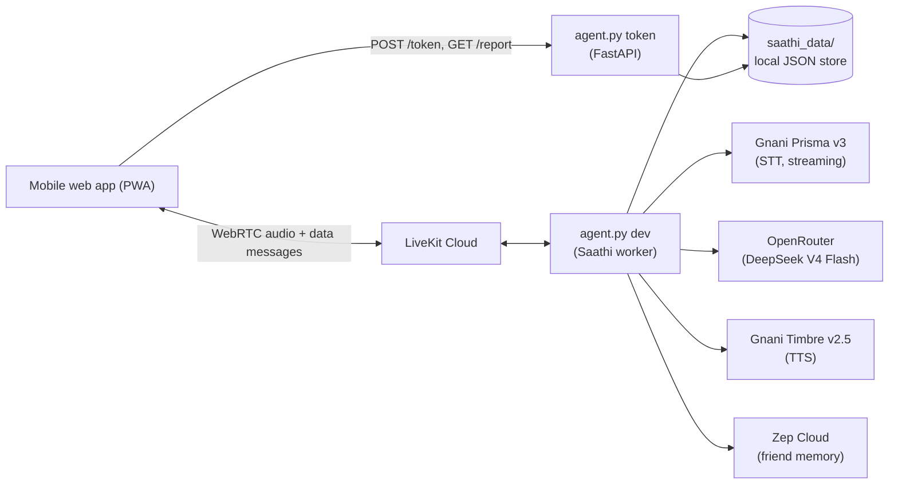

# Meter Chalu (मीटर चालू) — Backend

> **भाषा चालू, मीटर चालू!** *(Get your language going, and your meter keeps running.)*

Meter Chalu is a hands-free voice coach that helps auto and taxi drivers in Maharashtra practise everyday Marathi, with help in their own language. This repository is the **backend**: a LiveKit voice agent ("Saathi") plus a small HTTP server for join tokens and the Home-screen report. The mobile web app (PWA) is a separate client that talks to this backend.

Built for the Gnani AI challenge.

> ⚠️ **Practice aid only.** Meter Chalu is not an official test, does not certify anyone, and is not connected to any RTO. All role-plays are synthetic.

---

## Why

Maharashtra requires auto, taxi and app-cab drivers to have working Marathi, and the check is spoken. Many drivers are migrants who speak Hindi or another Indian language, work 12-hour shifts and can't attend classes. Meter Chalu lets them practise by *talking*, in the language they are most comfortable with, while a patient AI plays the passenger.

## What Saathi does

Saathi is a coach and a friend, not a chatbot.

- **Remembers him.** Long-term memory (Zep) lets it open like a friend: how he seemed last time, what it promised to follow up on, how many days it has been.
- **Steers to practice.** After a few chatty turns the code itself pushes the model to propose a situation. The goal of every session is that *he* speaks Marathi.
- **Plays the passenger.** Five synthetic role-plays: `dadar`, `fare`, `directions`, `elderly`, `rto`. The passenger speaks only short Marathi, in a Marathi voice.
- **Corrects and scores.** When his Marathi is wrong or unclear, Saathi explains in his helper language, says the right sentence slowly, and asks him to repeat it. The repeat is scored by a local fuzzy matcher (no LLM, no added latency) and shown as a live "how close" meter.
- **Reminds him where he went wrong.** Every correction is saved. Unmastered ones are brought up at the start of the next session, and a correction he slips on again is re-opened.
- **Speaks first.** If he goes quiet, Saathi generates a gentle nudge instead of waiting in silence.
- **Reports.** Everything feeds a Home-screen report: lines learned, streak, closeness trend, "fix these", last session recap.
- **Speaks his language.** Helper language is Hindi by default; Bengali, Telugu, Tamil, Kannada, Gujarati, Punjabi, Malayalam and English are supported.

## Architecture



The voice pipeline is a normal cascade, because the challenge requires Gnani's STT and TTS:

```
mic → Prisma v3 → text → LLM → text → Timbre → speaker
```

| Layer | Choice |
|---|---|
| Realtime / agents | LiveKit Agents (Python) |
| Speech-to-text | Gnani Prisma v3 (custom subclass of `livekit-plugins-gnani`, see below) |
| LLM | OpenRouter, default `deepseek/deepseek-v4-flash` (any OpenAI-compatible model works) |
| Text-to-speech | Gnani Timbre v2.5 (`Nalini` for Hindi, `Zahira` / `Ishaan` for Marathi, other helper voices below) |
| Long-term memory | Zep Cloud (v4 SDK) |
| Exact data | Local JSON files (corrections, scores, sessions, report) |
| HTTP | FastAPI + Uvicorn |

### Repository layout

```
.
├── agent.py        # voice agent + memory + corrections + report + token server (one file)
├── prisma_v3.py    # Prisma v3 streaming STT for LiveKit (subclass of the Gnani plugin)
├── .env            # your keys (never commit this)
└── saathi_data/    # created at runtime
    ├── drivers/<driver-id>.json   # per-driver profile, corrections, sessions
    └── latency_log.jsonl          # per-reply latency measurements
```

### Why `prisma_v3.py` exists

The official `livekit-plugins-gnani` STT opens its websocket with only four headers, so it talks to the default model and can't ask for Prisma v3, keyterms or VAD tuning. It also discards `detected_language_code`. `prisma_v3.py` subclasses the plugin's `STT` and `SpeechStream`, replaces only `_run` (headers) and `_recv_messages` (replies), and leaves audio sending untouched. It sends:

- `model: prisma-v3.0`, `language_code: indic-auto` (per-utterance Hindi / Marathi / English detection)
- Marathi place names and road words as **keyterms**, plus a `topic` hint
- VAD tuning headers (`x-vad-threshold`, `x-min-silence-ms`, …) for noisy auto stands

Header names come from the [Gnani STT websocket docs](https://docs.gnani.ai/api/STT/stt-websocket).

## Quick start

**Requirements:** Python 3.10+, a [LiveKit Cloud](https://cloud.livekit.io) project, Gnani API key(s), an OpenRouter key, and (optionally) a Zep Cloud key.

```bash
python -m venv .venv && source .venv/bin/activate
pip install livekit-agents livekit-plugins-gnani livekit-plugins-openai livekit-plugins-silero \
            zep-cloud fastapi uvicorn livekit-api python-dotenv
```

Create `.env`:

```bash
# LiveKit (LiveKit Cloud → Settings → Keys)
LIVEKIT_URL=wss://your-project.livekit.cloud
LIVEKIT_API_KEY=...
LIVEKIT_API_SECRET=...

# Models
OPENROUTER_API_KEY=sk-or-...
GNANI_API_KEYS=key1,key2,key3      # comma separated; each new session takes the next key

# Memory (optional: without it the agent runs with the local store only)
ZEP_API_KEY=...
```

Run the two processes (two terminals, same folder):

```bash
python agent.py dev      # the voice agent worker (or: python agent.py console)
python agent.py token    # token server + /report + /driver on port 8000
```

Check the token server:

```bash
curl http://localhost:8000/health
curl -X POST http://localhost:8000/token -H "Content-Type: application/json" \
  -d '{"roomName":"driver-test1234","participantName":"Ramesh","metadata":{"name":"Ramesh","helper_language":"hi"}}'
```

You can paste the returned `serverUrl` and `participantToken` into the [LiveKit Agents Playground](https://agents-playground.livekit.io) (custom connection) to talk to Saathi without the app.

> **Use headphones when testing with `console`.** Console mode has no echo cancellation, so Saathi can hear itself and interrupt itself. WebRTC clients (the app) have echo cancellation.

### Putting it on a phone

A phone browser blocks plain `http` calls from an HTTPS page, and `localhost` means the phone itself. For development, tunnel the token server:

```bash
cloudflared tunnel --url http://localhost:8000
```

Then paste the printed `https://….trycloudflare.com` address into the app's **Backend URL** setting (no trailing slash, no `/token`). For a stable address, deploy `python agent.py token` to Render, Railway or a VPS.

## HTTP API (`python agent.py token`)

| Method | Path | Purpose |
|---|---|---|
| `POST` | `/token` | Issue a LiveKit join token and dispatch the `saathi` agent into the room |
| `GET` | `/report?room=<roomName>` | Home-screen report for one driver |
| `DELETE` | `/driver?room=<roomName>` | "Forget me": deletes the Zep user (and graph) and the local file |
| `GET` | `/health` | Liveness check |

**`POST /token`**

```json
{
  "roomName": "driver-a4b2c1d0",
  "participantName": "रमेश",
  "agentName": "saathi",
  "metadata": { "name": "रमेश", "helper_language": "hi", "scenario": "dadar" }
}
```

Returns `{ "serverUrl": "wss://…", "participantToken": "…" }`.

- `roomName` is the **driver's identity** for memory and reports. Keep it ASCII and **reuse the same one for every session**.
- `metadata.scenario` is optional (a shortcut chip). Valid ids: `dadar`, `fare`, `directions`, `elderly`, `rto`. Omit it and the driver picks by voice.
- `helper_language`: `hi` (default), `bn`, `te`, `ta`, `kn`, `gu`, `pa`, `ml`, `en`.
- The metadata is attached to a `RoomAgentDispatch` for agent name `saathi`; the agent reads it as job metadata.

## Realtime protocol (LiveKit data messages)

Messages are JSON sent with `publish_data(..., reliable=True, topic=...)`. Decode with `JSON.parse(new TextDecoder().decode(payload))` on the client.

### Agent → app

| Topic | When | Payload |
|---|---|---|
| `target` | Saathi asks him to repeat a sentence | `{ "marathi": "…", "meaning": "…" }` |
| `closeness` | Right after he repeats it | `{ "score": 0-100, "words": [{ "w": "…", "state": "great"\|"almost"\|"miss" }], "heard": "…", "mastered": bool }` |
| `lesson` | When lines are added or learned | `{ "lines": [{ "marathi", "meaning", "learned", "best" }], "learned": n, "total": n }` |
| `readiness` | End of a role-play round | `{ "percent", "per_scenario", "ready", "note", "lines_learned", "words_learned", "lines_goal", "progress_percent", "scenario", "score", "detected_language" }` |
| `report` | On join, when a line is learned, and when a round ends | the full report (schema below) |

`detected_language` looks like `hi-IN`, not `hi`.

### App → agent

| Topic | Payload | Effect |
|---|---|---|
| `client` | `{ "scenario": "<id>" }` | Shortcut chip: Saathi says a short line and starts that role-play |

### Audio and transcripts

Audio flows over the normal LiveKit tracks. Transcripts reach the client through LiveKit's transcription stream, so the app should **not** use browser speech recognition or browser TTS in live mode.

## Home report schema

`GET /report` and the `report` data message return:

| Field | Meaning |
|---|---|
| `name` | Driver name |
| `percent` / `progress_percent` | Lines learned ÷ `LINES_GOAL`, capped at 100 |
| `lines_learned`, `words_learned`, `lines_goal` | Learning progress. A learned line stays learned even if he slips later |
| `per_scenario` | Best 0-100 "meaning got across" score per scenario |
| `ready` | `true` when every scenario's best ≥ 70 |
| `note` | The practice-aid disclaimer: always show it |
| `sessions`, `streak_days`, `days_since_last` | Consistency |
| `week` | Last 7 days: `[{ date, weekday (0 = Monday), practised, today }]` |
| `closeness_avg_recent`, `closeness_trend` | Average of the last 5 closeness scores; trend vs the 3 before (positive = improving) |
| `strong_in` | Scenario ids with a best score ≥ 70 |
| `fix_these` | Up to 5 open corrections: `[{ wrong, right, meaning, tip, times }]` |
| `fixed_count` | Same as `lines_learned` |
| `recent` | Last 5 sessions: `[{ date, scenario, score, closeness, lines, kind }]` |
| `last_session` | `{ date, scenario, score, summary, topics, lines, learned_count }` — the recap of the last call |
| `carry_forward` | One-line note Saathi left itself about how he seemed and what to revisit |

## How it works

### Two voices, two modes

Saathi runs in one of two modes and swaps the TTS voice with `update_options`:

- **Coach (friend) mode:** the helper-language voice (for example `Nalini` for Hindi). Used for greeting, chatting, explanations, corrections and feedback.
- **Role-play mode:** the scenario's Marathi voice (`Zahira` or `Ishaan`). Used for the passenger's lines.

### Tools the LLM can call

| Tool | What it does |
|---|---|
| `start_scenario(scenario_id)` | Starts a role-play: swaps instructions and voice, creates a session row, tells the model to speak the opening line |
| `correct_driver(...)` | Saves the correction (local store + Zep), sets the sentence he must repeat, publishes `target`, switches to the helper voice |
| `finish_scenario(score, feedback, carry_forward)` | Records the session and score, publishes `readiness` and `report`, gives Hindi (or helper-language) feedback, returns to coach mode |

### The correction loop

1. In a role-play his Marathi is wrong or unclear → model calls `correct_driver`.
2. Saathi explains in his language, says the right sentence slowly, asks him to repeat.
3. His repeat is scored locally by `score_attempt()`: each target word is matched against the heard words with `difflib.SequenceMatcher` (`great` ≥ 0.80, `almost` ≥ 0.55), blended 70/30 with whole-sentence similarity. No LLM call.
4. Score ≥ **75** → mastered ("शाबास!"), role-play resumes. Not yet → one more try (`MAX_TARGET_TRIES`, default 2), then it moves on and the line stays open for next time.

### Keeping it a coach, not a chatbot

Deterministic guards sit around the model: after `MAX_CHAT_TURNS` chatty turns a system note tells it to propose a situation, and after `MAX_DRIVER_TURNS` role-play replies it is told to call `finish_scenario`. Repeat attempts don't count toward the limit.

### Memory

- **Zep Cloud (v4):** one Zep user per driver, one thread per session. Zep generates the UUIDs, so the user uuid is stored in the driver's local file. Only the **driver's** words build his knowledge graph (assistant messages are excluded, so the passenger's lines never become "facts" about him). At session start, context is fetched using the **previous** thread as the query (a brand-new thread has nothing to search with). Writes go through one ordered background queue, so memory never adds latency to a voice turn.
- **Local store (`saathi_data/drivers/*.json`):** the things the app must be exact about: corrections, scores, sessions, streak, recap.
- **Prompt safety:** the memory block is passed as a framed *user-level* message, never in the system prompt, and the model is told it is data, not instructions.
- Without `ZEP_API_KEY`, or if Zep is slow to answer (`ZEP_START_TIMEOUT_S`), the agent runs on the local store alone.

### Call recap

When a call ends, a small model (`SUMMARY_MODEL`, default the same as `LLM_MODEL`) writes a two-sentence recap in his language plus up to 3 topic tags. If that fails or times out, the report falls back to a plain line like "You tried 3 lines and learned 2."

### Speech quality guards

- **Polite register and gender.** The prompt requires the polite "you" in every helper language and feminine self-reference to match Saathi's female voice.
- **Speech filter** (`SPEECH_FILTER=1`): `tts_node` drops any sentence that looks like internal text (tool names, parameter names, prompt words) before it reaches the voice.
- **Interruptions.** Short noises don't cut Saathi off (`INTERRUPT_MIN_DURATION`, default 0.8 s) and a false interruption resumes where it stopped.
- **Optional speaking speed.** `livekit-plugins-gnani` doesn't expose Gnani's `speed` parameter, so `TTS_SPEED` (0.85 to 1.15) is injected by wrapping the plugin's request serialisation. It is wrapped in a try/except and can't crash the agent; default is `1.0`.

### Latency

Every reply logs `LATENCY total (eou + llm + tts)` against a 2-second budget (`LATENCY_BUDGET_S`) and appends to `saathi_data/latency_log.jsonl`.

## Configuration

All settings are environment variables (`.env`).

| Variable | Default | Purpose |
|---|---|---|
| `LIVEKIT_URL`, `LIVEKIT_API_KEY`, `LIVEKIT_API_SECRET` | — | LiveKit project (agent and token server) |
| `OPENROUTER_API_KEY` | — | **Required.** LLM access |
| `OPENROUTER_BASE_URL` | `https://openrouter.ai/api/v1` | |
| `LLM_MODEL` | `deepseek/deepseek-v4-flash` | Copy the exact slug from openrouter.ai if it differs |
| `LLM_MAX_TOKENS` | `300` | Devanagari uses many tokens and tool calls carry Marathi text |
| `LLM_DISABLE_REASONING` | `1` | Sends `reasoning: {enabled: false}`; set `0` if the model rejects it |
| `GNANI_API_KEYS` / `GNANI_API_KEY` | — | **Required.** Comma-separated keys, rotated per session (Timbre allows one active request per key) |
| `ZEP_API_KEY` | — | Optional long-term memory |
| `ZEP_START_TIMEOUT_S` | `3` | How long to wait for Zep at session start |
| `COACH_VOICE` | helper default | Override the helper voice (e.g. to test another Timbre voice) |
| `TTS_SPEED` | `1.0` | 0.85–1.15 |
| `TTS_SAMPLE_RATE` | `22050` | |
| `STT_VAD_THRESHOLD` | `0.6` | Prisma server-side VAD |
| `STT_MIN_SILENCE_MS` | `600` | Lower = faster replies, but pauses mid-sentence split the turn |
| `TURN_DETECTION` | `stt` | Set `vad` as a fallback if replies stop |
| `INTERRUPT_MIN_DURATION` | `0.8` | Seconds of speech before it counts as an interruption |
| `PREEMPTIVE_TTS` | `0` | Leave off unless safe: Timbre allows one active request per key |
| `MAX_DRIVER_TURNS` | `5` | Role-play replies before wrap-up |
| `MAX_CHAT_TURNS` | `3` | Chatty turns before steering to practice |
| `MAX_TARGET_TRIES` | `2` | Repeat attempts per correction |
| `NUDGE_GAP_S` | `10` | Gap between "Saathi speaks first" nudges |
| `LINES_GOAL` | `20` | Lines learned = 100% on the progress ring |
| `SUMMARY_MODEL`, `SUMMARY_TIMEOUT_S` | `LLM_MODEL`, `12` | Call recap |
| `SPEECH_FILTER` | `1` | Drop internal-looking sentences before TTS |
| `LATENCY_BUDGET_S` | `2.0` | Budget used in the latency log |
| `PORT` | `8000` | Token server port |

## Deployment notes

- **Agent:** run `python agent.py start` on a VPS, or deploy with the LiveKit CLI. The worker connects *outward* to LiveKit Cloud, so it needs no public IP.
- **Token server:** needs a public HTTPS URL (Render, Railway, a VPS behind a reverse proxy, or a Cloudflare tunnel for dev).
- **Shared storage:** `/report` reads `saathi_data/`, which the agent writes. They must share a filesystem (same machine or a mounted volume) until the store moves to a real database.
- **Secrets:** keys live only in the backend `.env`; the app never sees them.

## Privacy

- Each driver's data lives in `saathi_data/drivers/<id>.json` and, if Zep is enabled, in a Zep user containing the driver's own spoken words and extracted facts.
- `DELETE /driver?room=<roomName>` removes both. The app should expose this as a clear "delete my data" control, and drivers should be told that Saathi remembers them.
- The project's synthetic-data rule still applies to demos: use consenting participants and no real phone numbers, Aadhaar numbers or recorded calls.

## Known limitations

- **No authentication.** The room name acts as the driver id, so anyone who knows it can read or delete that driver's report, and CORS is open (`*`). Fine for a demo; add auth and restrict origins before going public.
- **Final transcripts only.** The Prisma wrapper emits only final transcripts, so the "how close" score appears right after a sentence ends, not word by word while speaking.
- **One voice per utterance.** The correct Marathi sentence inside a correction is spoken by the helper-language voice, so it won't sound native Marathi. A second TTS instance would fix this.
- **Score measures what was recognised,** not phoneme-level pronunciation. Treat it as "how close", not a pronunciation grade.
- **Local JSON store** doesn't scale beyond a single machine.
- **`TTS_SPEED`** relies on wrapping a plugin internal and may stop working after a plugin update.

## Troubleshooting

| Symptom | Likely cause / fix |
|---|---|
| `ImportError: cannot import name 'openai' from 'livekit.plugins'` | `pip install livekit-plugins-openai` into the same venv |
| Connects but Saathi never speaks | The agent wasn't dispatched. Check `python agent.py dev` is running and the agent name is `saathi` in both the decorator and the token |
| No first greeting | The greeting is sent after the driver joins the room; check the logs for `GREETING now` |
| Speech stops and restarts | Echo in `console` mode (use headphones), or noise. Tune `INTERRUPT_MIN_DURATION` and `STT_MIN_SILENCE_MS`; check the `LATENCY` lines for a slow LLM or TTS |
| HTTP 401 from Gnani | Bad key, wrong `.env`, or no credits |
| Gnani errors under load | One active Timbre request per key: add more keys to `GNANI_API_KEYS` |
| Model rejects the request | Set `LLM_DISABLE_REASONING=0`; confirm the `LLM_MODEL` slug on openrouter.ai |
| Memory isn't saved | Check `ZEP_API_KEY`, `pip install zep-cloud`, and the `zep` warnings in the log |
| App gets a CORS or network error | Wrong Backend URL, tunnel stopped, or the token server isn't running; open `<url>/health` in the phone browser |
| `/report` is empty | It fills as soon as he speaks, and the progress ring moves when a line is learned. A full role-play round adds the score |

## Roadmap

- WhatsApp voice-note mode and phone-call mode for basic phones (Gnani 8 kHz telephony + LiveKit phone support)
- Community situation library from anonymised custom situations
- Move the local store to a real database; add authentication
- Scale within Maharashtra: Mumbai, Pune, Nagpur, Nashik

## Credits

Built with [LiveKit Agents](https://docs.livekit.io/agents/), [Gnani AI](https://gnani.ai) (Prisma v3 STT, Timbre v2.5 TTS), [OpenRouter](https://openrouter.ai), and [Zep](https://www.getzep.com).