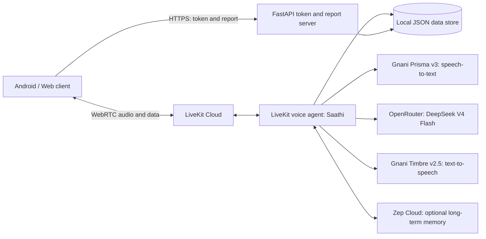

🚖 Meter Chalu (मीटर चालू)
भाषा चालू, मीटर चालू!
Keep your Marathi flowing, keep your meter running.

Meter Chalu is a voice-first Marathi practice coach designed for auto-rickshaw and taxi drivers in Maharashtra. Drivers practise everyday passenger conversations by speaking with Saathi (साथी), an AI coach that can explain in a familiar helper language, play realistic passenger scenarios, correct mistakes, and remember what needs more practice.

The project combines a mobile experience with a real-time voice agent. Audio is streamed through LiveKit WebRTC, while the backend handles speech recognition, language-model responses, speech synthesis, driver progress, and optional long-term memory.

Built for the Gnani AI Challenge.
Important: Meter Chalu is an independent language-practice aid. It is not an official examination, does not certify language proficiency, and is not affiliated with an RTO or government authority. Role-plays are synthetic. Practise while safely parked or off duty—never interact with the app while driving.

Contents
- What it does
- Features
- Practice scenarios
- How it works
- Technology
- Repository structure
- Getting started
- Configuration
- HTTP API
- LiveKit data messages
- Progress and scoring
- Memory and privacy
- Known limitations
- Deployment
- Acknowledgements
- License
What it does
Many drivers who work in Maharashtra speak Hindi or another Indian language as their first language. Everyday interactions with passengers—understanding a destination, discussing a fare, giving directions, or responding politely—can be difficult without confidence in spoken Marathi.

Meter Chalu makes practice conversational rather than textbook-based:
1. The driver starts a voice session with Saathi.
2. Saathi chats briefly in the driver's chosen helper language.
3. The driver practises a realistic passenger interaction in Marathi.
4. If a response is unclear or incorrect, Saathi explains the issue and gives a sentence to repeat.
5. The app shows how closely the repeated sentence matches the target.
6. Corrections and progress carry over to future sessions.
The goal is practical spoken confidence through repeated, contextual practice.
Features
Voice-first conversations
- A natural, hands-free-style voice conversation powered by LiveKit.
- Saathi can greet the driver and speak first.
- Streaming speech recognition and generated speech keep the conversation flowing.
- Voice activity detection and interruption handling support conversational turn-taking.
Use the experience only when it is safe to do so; the app is intended for practice while parked or off duty.
Guided passenger role-plays
Practise common situations such as finding a destination, discussing fares, and speaking politely with passengers. Saathi plays the passenger and keeps the Marathi dialogue focused and manageable.
Corrections and a live closeness score
- Saathi explains corrections in the selected helper language.
- The target Marathi sentence is presented for repetition.
- A local fuzzy matcher compares the recognised attempt with the target.
- Word-level feedback is shown as Great, Almost, or Miss.
- A score from 0–100 communicates how closely the attempt matched.
The score is a text-similarity aid, not a phoneme-level pronunciation assessment.
Persistent learning progress
- Corrections are saved for later practice.
- Unmastered sentences can be revisited in a future session.
- Learned lines, session history, streaks, and recent progress feed the Home-screen report.
- Saathi can use a short session recap to pick up the conversation next time.
Multiple helper languages
Hindi is the default helper language. The backend also supports Bengali, Telugu, Tamil, Kannada, Gujarati, Punjabi, Malayalam, and English.
Practice scenarios
Scenario ID	Situation	Practice focus
dadar	Dadar station	Destinations, routes, traffic, and drop-offs
fare	Fare and meter	Fare questions, payment, change, and luggage
directions	Roads and directions	Turns, landmarks, flyovers, and routes
elderly	Elderly passenger	Polite conversation and offering assistance
rto	RTO-related interaction	Practising courteous responses in a transport-check scenario

The scenarios are synthetic learning exercises. The rto scenario is not an official test or a substitute for current government requirements.
How it works
Architecture

Voice pipeline
Microphone
   ↓
LiveKit WebRTC audio track
   ↓
Gnani Prisma v3 (streaming speech-to-text)
   ↓
OpenRouter / DeepSeek V4 Flash
   ↓
Gnani Timbre v2.5 (text-to-speech)
   ↓
LiveKit WebRTC audio track
   ↓
Speaker
The client uses HTTP for token issuance and report retrieval. LiveKit carries real-time audio, transcripts, and application data messages.
Two conversation modes
Coach mode uses the driver's helper-language voice for greetings, explanations, corrections, and feedback.

Role-play mode uses a Marathi passenger voice for the scenario dialogue. Saathi switches between these modes as the practice session progresses.
The correction loop
1. Saathi identifies a response that needs correction.
2. The agent saves the correction and publishes the target sentence to the client.
3. Saathi explains the sentence and asks the driver to repeat it.
4. The recognised attempt is compared locally with the target using difflib.SequenceMatcher.
5. A sufficiently close attempt is marked as mastered. Otherwise, the driver gets another attempt; unresolved lines remain available for later practice.
The matcher uses word-level similarity and whole-sentence similarity. It does not evaluate pronunciation at the phoneme level.
Technology
Component	Technology
Real-time audio and rooms	LiveKit Cloud and WebRTC
Voice agent	LiveKit Agents for Python
Speech-to-text	Gnani Prisma v3
Language model	DeepSeek V4 Flash through OpenRouter
Text-to-speech	Gnani Timbre v2.5
Long-term conversational memory	Zep Cloud
HTTP API	FastAPI and Uvicorn
Persistent progress	Local JSON files
Android client	Kotlin and Jetpack Compose
Web client	React and TypeScript

Repository structure
The backend repository is organised around the voice agent and its HTTP service:
.
├── agent.py        # Saathi voice agent, memory, progress, reports, and token server
├── prisma_v3.py   # Prisma v3 streaming STT integration for LiveKit
├── .env           # Local credentials; do not commit
└── saathi_data/   # Created at runtime
    ├── drivers/   # Per-driver profiles, corrections, and sessions
    └── latency_log.jsonl
The Android and web clients are separate client applications. They connect to this backend through the token/report HTTP API and LiveKit.
Getting started
Requirements
- Python 3.10 or newer
- A LiveKit Cloud project
- Gnani API access for Prisma STT and Timbre TTS
- An OpenRouter API key
- A Zep Cloud API key for optional long-term memory
1. Set up the backend environment
Create and activate a virtual environment:
python -m venv .venv
source .venv/bin/activate
On Windows PowerShell:
py -m venv .venv
.venv\Scripts\Activate.ps1
Install the dependencies:
pip install livekit-agents livekit-plugins-gnani livekit-plugins-openai livekit-plugins-silero zep-cloud fastapi uvicorn livekit-api python-dotenv
2. Configure environment variables
Create a .env file in the backend project directory and add the credentials for the services you use:
LIVEKIT_URL=
LIVEKIT_API_KEY=
LIVEKIT_API_SECRET=

OPENROUTER_API_KEY=

# Use a comma-separated list if you have multiple Gnani keys.
GNANI_API_KEYS=

# Optional: without this, the local JSON store is used without Zep memory.
ZEP_API_KEY=
Keep this file private. Do not commit API keys, access tokens, or service credentials to Git.
3. Start the services
Run the token/report server in one terminal:
python agent.py token
Run the LiveKit agent worker in another terminal:
python agent.py dev
The HTTP server listens on port 8000 by default.
4. Check the server
curl http://localhost:8000/health
A successful health response confirms that the HTTP service is reachable. To create a test room and request a participant token:
curl -X POST http://localhost:8000/token \
  -H "Content-Type: application/json" \
  -d '{
    "roomName": "driver-test1234",
    "participantName": "Ramesh",
    "metadata": {
      "name": "Ramesh",
      "helper_language": "hi"
    }
  }'
The response contains the LiveKit server URL and participant token. These are session credentials; do not publish real tokens in logs, screenshots, or issue reports.

For a quick backend-only test, the returned connection details can be used with the LiveKit Agents Playground's custom connection option.
Configuration
All backend settings are read from environment variables.
Variable	Default	Purpose
LIVEKIT_URL	—	LiveKit project URL
LIVEKIT_API_KEY	—	LiveKit API key
LIVEKIT_API_SECRET	—	LiveKit API secret
OPENROUTER_API_KEY	—	OpenRouter authentication; required
OPENROUTER_BASE_URL	https://openrouter.ai/api/v1	OpenRouter-compatible API endpoint
LLM_MODEL	deepseek/deepseek-v4-flash	Model slug used for responses
LLM_MAX_TOKENS	300	Maximum response tokens
LLM_DISABLE_REASONING	1	Sends reasoning disabled when supported
GNANI_API_KEYS	—	Comma-separated Gnani keys; required for configured speech services
GNANI_API_KEY	—	Single-key alternative
ZEP_API_KEY	—	Optional Zep Cloud memory
ZEP_START_TIMEOUT_S	3	Maximum wait for Zep context at session start
COACH_VOICE	Helper-language default	Override the coach voice
TTS_SPEED	1.0	Speech speed; supported range is 0.85–1.15
TTS_SAMPLE_RATE	22050	TTS sample rate
STT_VAD_THRESHOLD	0.6	Prisma server-side voice activity threshold
STT_MIN_SILENCE_MS	600	Silence duration used for turn detection
TURN_DETECTION	stt	Turn detection mode; vad is available as a fallback
INTERRUPT_MIN_DURATION	0.8	Minimum speech duration before an interruption is accepted
PREEMPTIVE_TTS	0	Preemptive speech generation; leave disabled unless safe for the configured TTS key limits
MAX_DRIVER_TURNS	5	Role-play replies before wrap-up
MAX_CHAT_TURNS	3	Chat turns before steering toward practice
MAX_TARGET_TRIES	2	Repeat attempts per correction
NUDGE_GAP_S	10	Minimum gap between proactive nudges
LINES_GOAL	20	Learned-line goal used for progress
SUMMARY_MODEL	Same as LLM_MODEL	Model used for session recaps
SUMMARY_TIMEOUT_S	12	Session recap timeout
SPEECH_FILTER	1	Filters internal-looking text before TTS
LATENCY_BUDGET_S	2.0	Reply-latency budget recorded in logs
PORT	8000	FastAPI server port

HTTP API
The token server exposes the following endpoints:
Method	Endpoint	Purpose
POST	/token	Issues a LiveKit participant token and dispatches Saathi into the room
GET	/report?room={roomName}	Returns a driver's progress report
DELETE	/driver?room={roomName}	Deletes the driver's local data and associated Zep user data
GET	/health	Health check

Token request
Example request body:
{
  "roomName": "driver-a4b2c1d0",
  "participantName": "रमेश",
  "agentName": "saathi",
  "metadata": {
    "name": "रमेश",
    "helper_language": "hi",
    "scenario": "dadar"
  }
}
roomName is used as the driver's identity for memory and reports. Reuse the same room name for that driver's future sessions. Keep it unique and ASCII-safe.

Supported helper_language values:
Code	Language
hi	Hindi (default)
bn	Bengali
te	Telugu
ta	Tamil
kn	Kannada
gu	Gujarati
pa	Punjabi
ml	Malayalam
en	English

The optional scenario field accepts dadar, fare, directions, elderly, or rto.
LiveKit data messages
Application messages are JSON payloads published over LiveKit data messages. Clients should decode the payload and handle each topic.
Topic	Direction	Purpose
target	Agent → app	Marathi sentence to repeat, with its helper-language meaning
closeness	Agent → app	Similarity score, word-level states, recognised attempt, and mastery status
lesson	Agent → app	Current practice lines and learned-line counts
readiness	Agent → app	Role-play result and readiness/progress information
report	Agent → app	Full Home-screen progress report
client	App → agent	Starts a selected scenario, for example {"scenario":"fare"}

Audio is carried over LiveKit audio tracks. Transcripts are delivered through LiveKit's transcription stream; the client should not run a separate browser speech-recognition or browser text-to-speech pipeline during a LiveKit session.
Progress and scoring
The Home-screen report includes:
- Driver name and overall progress toward the configured line goal
- Learned lines and words
- Best score per scenario
- Session count and practice streak
- Recent closeness average and trend
- Corrections still to practise
- Recent sessions and the latest session recap
- A short carry-forward note for the next session
The correction matcher uses recognised text to estimate how closely an attempt matches the target sentence. It is designed as immediate practice feedback, not as an official language score or a clinical/acoustic pronunciation measurement.
Memory and privacy
Meter Chalu uses two kinds of persistence:
- Local JSON store: Holds the information the app needs to report accurately, including corrections, scores, sessions, streaks, and recaps.
- Zep Cloud (optional): Stores conversational memory for continuity between sessions. If Zep is not configured or is unavailable, the agent can continue using the local store.
The backend is designed to keep service credentials on the server. The client receives a short-lived LiveKit participant token, not the LiveKit API secret or provider API keys.

The DELETE /driver endpoint is intended to remove a driver's local data and associated Zep user data. Make the delete-data option clear to users and explain that memory is enabled when Zep is configured.
Before deploying publicly
The current demo backend has important security limitations:
- The room name acts as the driver identifier. Anyone who knows it may be able to access that driver's report or request deletion.
- CORS is open (*).
- The local JSON store is intended for a single-machine setup and is not suitable for multi-instance scaling.
- The report and delete endpoints need proper authentication and authorization before public production use.
Use synthetic demo data and consenting participants. Do not use real phone numbers, Aadhaar numbers, or private recorded conversations in demos.
Known limitations
- The current Prisma wrapper emits final transcripts, so the closeness score appears after a sentence ends rather than word-by-word during speech.
- The closeness score measures recognised-text similarity, not phoneme-level pronunciation.
- The corrected Marathi sentence may be spoken using the helper-language voice in the correction flow.
- The local JSON store is not designed for multi-instance or high-scale deployment.
- The TTS_SPEED integration wraps a plugin request-serialization detail and may need updating if the underlying plugin changes.
- Console testing does not provide the same echo cancellation as a WebRTC client. Use headphones when testing in console mode.
Deployment
The agent worker connects outward to LiveKit Cloud, so it does not need a public IP address. The token/report server does need a publicly reachable HTTPS endpoint for mobile clients.

Typical deployment arrangement:
- Agent worker: Run python agent.py start on a VPS or deploy it with the LiveKit CLI.
- Token/report server: Run python agent.py token behind HTTPS on a host such as a VPS, Render, or Railway.
- Shared data: The agent and HTTP server must access the same saathi_data/ directory while the project uses local JSON storage.
For local phone testing, a secure tunnel can expose the development token server:
cloudflared tunnel --url http://localhost:8000
Configure the client with the HTTPS tunnel address as its backend URL. Do not include /token in the base URL.
Acknowledgements
Built with:
- LiveKit Agents — real-time voice agent infrastructure
- Gnani AI — Prisma v3 speech recognition and Timbre speech synthesis
- OpenRouter — language-model access
- Zep — optional conversational memory
- FastAPI — backend HTTP API
